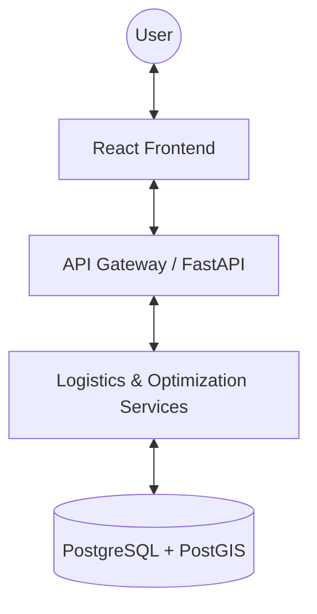
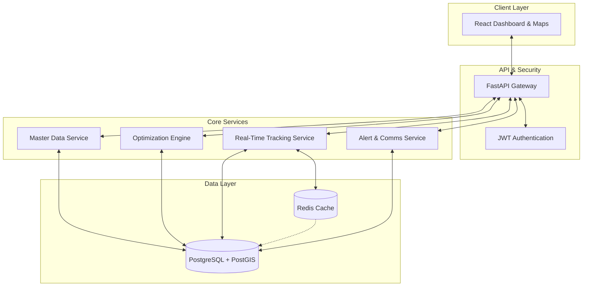

# System Architecture Diagrams

This document contains Mermaid diagrams representing the architecture of the **Centralized Vehicle Allocation and Logistics Optimization System**.

## 1. Brief Architecture (High-Level Overview)

A simplified view of the primary system layers and their interactions.



---

## 2. Medium Architecture (Component-Based)

A balanced view showing the major micro-modules and the dual-database strategy.



---

## 3. Detailed Architecture (Deep Dive)

A comprehensive view of internal components, specific technologies, and detailed data flow.

```mermaid
flowchart TD
    subgraph Frontend ["Frontend Ecosystem (React/Leaflet)"]
        Dashboard[KPI Dashboard]
        TripForms[Trip Scheduling & Management]
        LiveTracking[Live Tracking Map]
    end

    subgraph Backend ["Backend Ecosystem (FastAPI)"]
        subgraph Security ["Security Layer"]
            JWT[JWT OAuth2 Logic]
        end
        
        subgraph Logic ["Business Logic"]
            MasterSvc[Master Data: Vehicles/Drivers]
            TripMgr[Trip Lifecycle Manager]
            WS_Track[WebSocket Tracking Handler]
            AlertSvc[Maintenance & Compliance Alerts]
        end
        
        subgraph AI_Engine ["Optimization & AI Engine"]
            ORTools[Google OR-Tools MDVRP Solver]
            ConstraintMgr[Constraint & Goal Logger]
            XAI[Explainability Engine (XAI)]
        end
    end

    subgraph Persistence ["Data & Persistence"]
        PG[(PostgreSQL + PostGIS)]
        RCache[(Redis: Volatile GPS Data)]
    end

    subgraph External ["External Integrations"]
        EMail[Email/SMS API (SMTP/Twilio)]
        GPS[Mobile GPS Clients]
    end

    %% Interactions
    Dashboard <--> JWT
    TripForms <--> TripMgr
    LiveTracking <--> WS_Track
    
    TripMgr <--> MasterSvc
    TripMgr <--> AI_Engine
    AI_Engine <--> PG
    MasterSvc <--> PG
    
    WS_Track <--> RCache
    RCache -.-> PG
    GPS -- REST --> WS_Track
    
    AlertSvc <--> PG
    AlertSvc --> External
    
    %% Specific Flows
    ORTools <--> ConstraintMgr
    ConstraintMgr --> XAI
    XAI -.-> Dashboard
```
