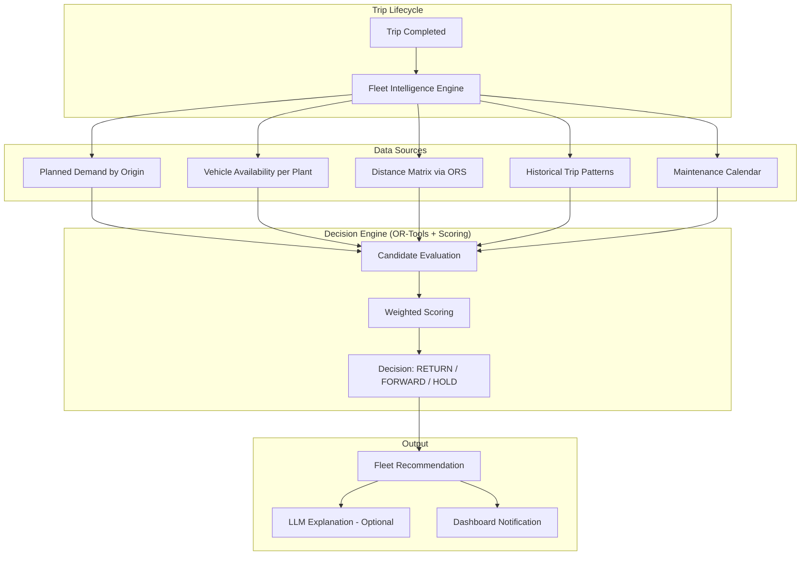
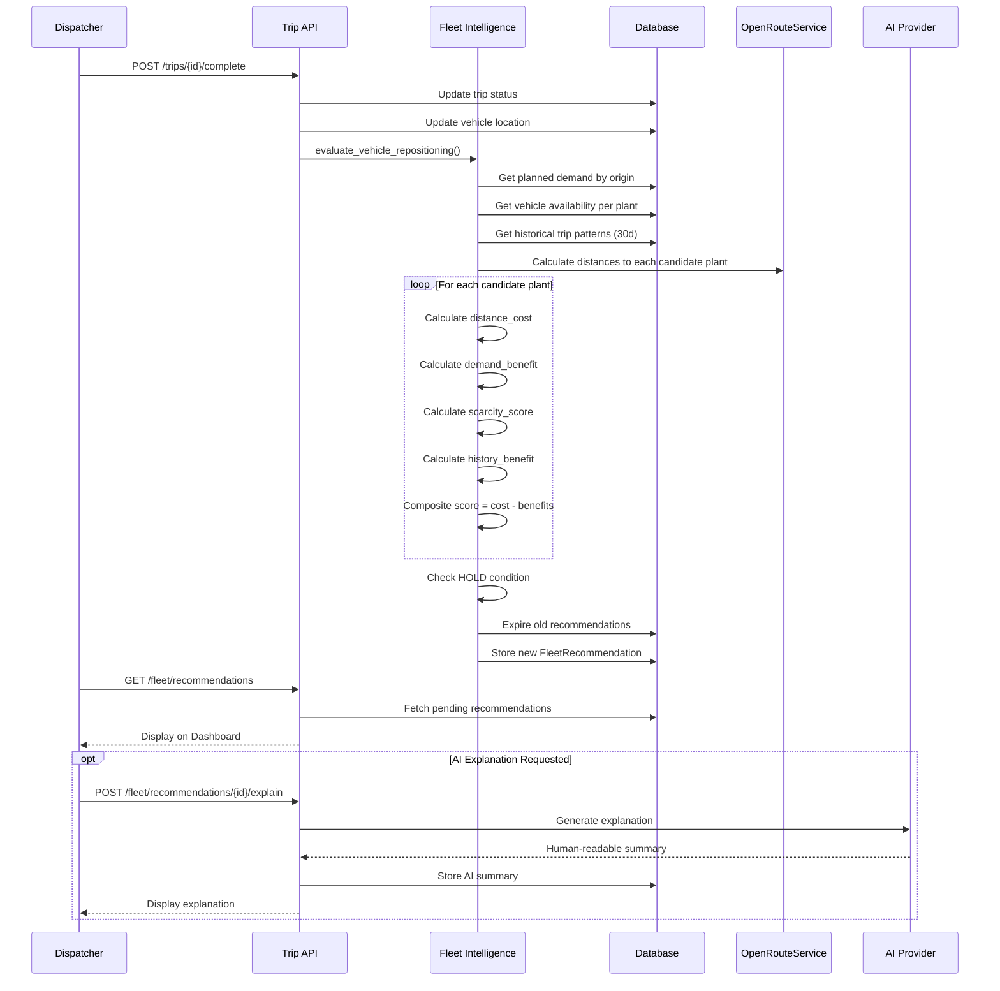
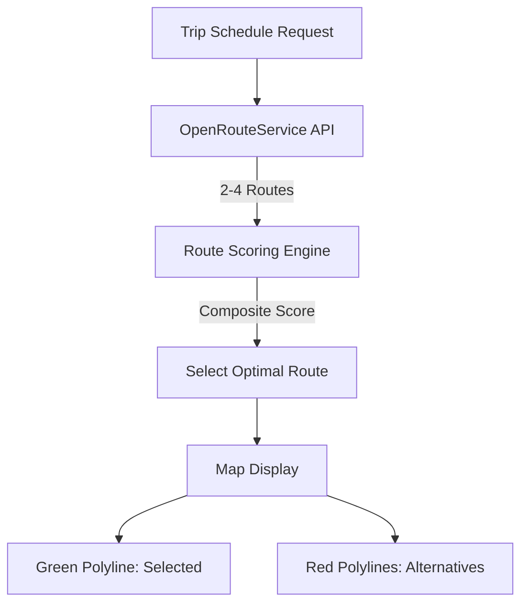
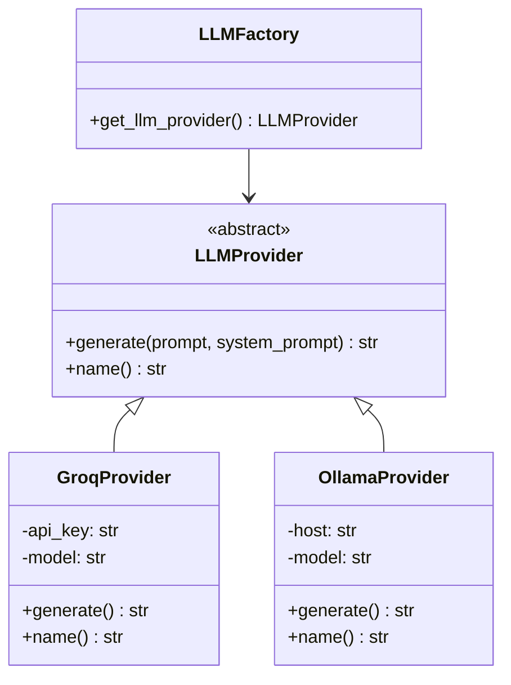
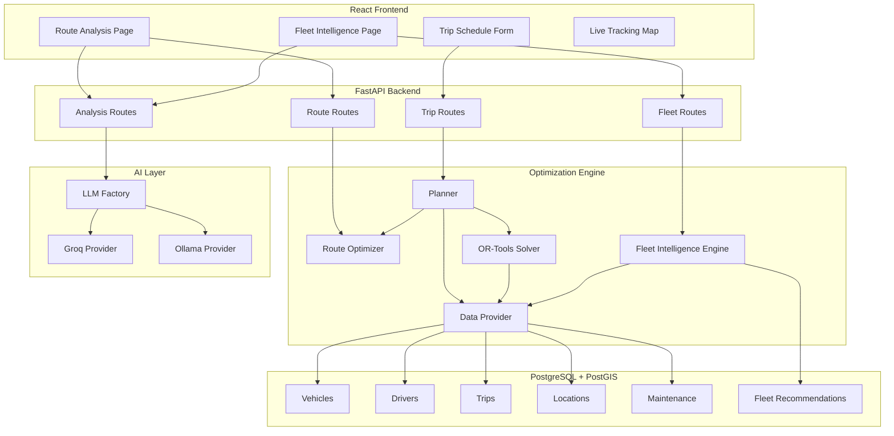

# Multi-Plant Logistics Intelligence System

## Technical Documentation for Capstone Presentation

---

## 1. Problem Statement

In a multi-plant fleet management system, vehicles frequently complete trips at locations **different from their home base**. The critical question becomes:

> **After Vehicle V completes a trip at Plant B (having originated from Plant A), should it return to A, move forward to Plant C, or stay at B?**

Making this decision manually is:
- **Time-consuming**: Dispatchers must check demand, availability, and distances across all plants
- **Sub-optimal**: Human intuition often defaults to "return to base" even when forward-dispatch saves costs
- **Reactive**: Decisions are made after arrival, missing preparation opportunities

---

## 2. Our Solution: Weighted Multi-Factor Dispatch Intelligence

We built an **algorithmic decision engine** (no AI/ML for the core decision) that automatically evaluates repositioning options and generates recommendations.

### 2.1 Architecture Overview



### 2.2 Decision Flow — Sequence Diagram



---

## 3. Scoring Algorithm

The core decision uses a **composite scoring function** where **lower is better**:

```
Score(plant_i) = DistanceCost(i) - DemandBenefit(i) - ScarcityScore(i) - HistoryBenefit(i) - ReturnBonus(i)
```

### Factor Breakdown

| Factor | Formula | Weight | Rationale |
|--------|---------|--------|-----------|
| **Distance Cost** | `distance_km × vehicle.cost_per_km` | Primary | Minimize transport cost |
| **Demand Benefit** | `planned_trips × 20.0` | High | Prefer plants with pending trips |
| **Scarcity Score** | `max(0, 3 - available_vehicles) × 15.0` | Medium | Prefer plants with fewer vehicles |
| **History Benefit** | `recent_trips_30d × 2.0` | Low | Prefer historically busy plants |
| **Return Bonus** | `10.0 if source plant` | Small | Slight preference for returning |

### HOLD Condition

The system recommends **HOLD** when:
1. There is planned demand at the **current** location
2. The vehicle is one of ≤1 available vehicles at this location
3. The best forward-dispatch score is positive (costly)

---

## 4. Vehicle Selection — Density-Aware Optimization

### 4.1 Problem

Traditional systems select vehicles based only on **weight capacity**. But:
- A 10-ton truck carrying cotton bales needs **volume**, not weight
- A pickup carrying iron rods needs **weight capacity** and **density tolerance**
- An oversized vehicle wastes fuel on small shipments

### 4.2 Our Approach

```mermaid
flowchart LR
    subgraph Input["Trip Request"]
        CW[Cargo Weight: 5000 kg]
        CV[Cargo Volume: 25 m³]
        CT[Cargo Type: Cotton/Textile]
    end

    subgraph Filter["Eligibility Filter"]
        WF[Weight ≤ Capacity?]
        VF[Volume ≤ Volume Capacity?]
    end

    subgraph Score["Suitability Scoring"]
        TS[Type Suitability: 0.0-1.0]
        DS[Density Compatibility]
        UE[Utilization Efficiency]
        FM[Fuel/Mileage Factor]
    end

    subgraph Solver["OR-Tools CP-SAT"]
        OBJ[Minimize: TransportCost + FuelPenalty + UnsuitabilityPenalty - IdleBonus - RatingBonus]
    end

    Input --> Filter
    Filter --> Score
    Score --> Solver
    Solver --> |Best Pair| RESULT[Vehicle + Driver Assignment]
```



### 4.3 Cargo Suitability Scoring

```python
def compute_cargo_suitability(vehicle, cargo_type, weight, volume):
    score = 1.0

    # Type match check
    if cargo_type in vehicle.suitable_types:
        score *= 1.0  # Perfect match
    elif "General" in vehicle.suitable_types:
        score *= 0.7  # General vehicle, specialized cargo
    else:
        score *= 0.3  # Poor match

    # Density check
    if volume > 0:
        density = weight / volume
        if density > vehicle.max_density:
            score *= 0.4  # Exceeds structural limits

    # Utilization efficiency
    utilization = weight / vehicle.capacity
    if utilization < 0.1:
        score *= 0.6  # Way too big
    elif utilization < 0.3:
        score *= 0.8  # Somewhat oversized

    return score
```

### 4.4 OR-Tools Objective Function

The solver minimizes a **weighted cost function** that combines:

| Term | Description |
|------|-------------|
| `base_transport_cost` | `(route_distance + reposition_distance) × cost_per_km` |
| `driver_reposition_cost` | `driver_reposition_km × 0.35` |
| `maintenance_penalty` | `maintenance_events_180d × 7.0` |
| `vehicle_usage_penalty` | `recent_trips_90d × 2.5` |
| `driver_usage_penalty` | `recent_trips_90d × 2.0` |
| `fuel_cost_penalty` | `(distance / effective_mileage) × 3.0` |
| `cargo_unsuitability` | `(1.0 - suitability_score) × 25.0` |
| `idle_bonus` (negative) | `idle_days × 0.5` |
| `rating_bonus` (negative) | `driver_rating × 3.0` |
| `same_plant_bonus` (negative) | `5.0 if vehicle or driver at source plant` |

---

## 5. Route Optimization — Multi-Alternative Visualization

### 5.1 How It Works



### 5.2 Route Scoring

Each route alternative is scored based on:
- **Distance** (km) — Weight: 1.0
- **Duration** (minutes) — Weight: 0.5
- **Fuel consumption** (`distance / effective_mileage`) — Weight: 5.0
- **Elevation penalty** (`total_ascent × 0.001`) — Weight: 2.0

The route with the **lowest composite score** is selected.

---

## 6. AI/LLM Integration — Explainable Summaries

### 6.1 Abstraction Pattern



### 6.2 Key Design Decisions

| Decision | Rationale |
|----------|-----------|
| AI is NOT used for routing | Route planning must be deterministic and auditable |
| AI is ONLY for summaries | Human-readable explanations of algorithmic decisions |
| Provider is swappable via .env | No code changes needed to switch providers |
| Graceful degradation | If AI is unavailable, system continues with raw summaries |

### 6.3 Configuration

```env
# .env file
LLM_PROVIDER=groq        # groq | ollama
GROQ_API_KEY=gsk_xxx
GROQ_MODEL=llama-3.1-70b-versatile
OLLAMA_HOST=http://localhost:11434
OLLAMA_MODEL=qwen2:7b
```

---

## 7. System Data Flow — Complete Picture



---

## 8. Technology Stack

| Layer | Technology | Purpose |
|-------|-----------|---------|
| Frontend | React 19 + Leaflet + Vite | Interactive map with route polylines |
| Backend | FastAPI (Python 3.11) | REST API + WebSocket |
| Database | PostgreSQL + PostGIS | Geospatial data & fleet records |
| Optimizer | Google OR-Tools CP-SAT | Vehicle/driver assignment |
| Routing | OpenRouteService API | Road distances & route geometry |
| AI (Cloud) | Groq API (LLaMA 3.1 70B) | Cloud-based summaries |
| AI (Local) | Ollama + Qwen 7B | Local AI alternative |
| Real-Time | WebSocket + OwnTracks | GPS tracking |

---

## 9. Example Scenario

### Setup
- **3 Plants**: Chakan (Pune), Bhiwandi (Mumbai), Sanand (Ahmedabad)
- Vehicle V001 (10T Truck) completes delivery: Chakan → Bhiwandi
- 2 planned trips from Sanand, 0 from Chakan, 1 vehicle available at Sanand

### System Decision

| Candidate | Distance | Cost | Demand | Vehicles | Score |
|-----------|----------|------|--------|----------|-------|
| Return to Chakan | 145 km | ₹6,525 | 0 trips | 2 | 6,525 - 0 - 0 - 10 = **6,515** |
| Forward to Sanand | 520 km | ₹23,400 | 2 trips | 1 | 23,400 - 40 - 30 - 0 = **23,330** |

**Decision**: RETURN to Chakan (lower score = better)

But if Sanand had **5 planned trips and 0 vehicles**:

| Candidate | Distance | Cost | Demand | Vehicles | Score |
|-----------|----------|------|--------|----------|-------|
| Return to Chakan | 145 km | ₹6,525 | 0 trips | 2 | **6,515** |
| Forward to Sanand | 520 km | ₹23,400 | 5 trips | 0 | 23,400 - 100 - 45 - 0 = **23,255** |

**Decision**: Still RETURN (distance cost dominates)

If distance was shorter (e.g., 200 km):
| Forward to Sanand | 200 km | ₹9,000 | 5 trips | 0 | 9,000 - 100 - 45 = **8,855** |

**Decision**: Now FORWARD_DISPATCH is competitive, and the system recommends it.

---

## 10. Key Differentiators

1. **Deterministic + Explainable**: Core decisions use OR-Tools (auditable math), AI only explains
2. **Density-Aware**: Goes beyond weight — considers cargo type, volume, and density
3. **Multi-Route Visual**: Shows ALL considered routes on the map, not just the chosen one
4. **Proactive**: Auto-generates recommendations on trip completion without user prompting
5. **Provider-Agnostic AI**: Switch between cloud (Groq) and local (Ollama) via config
6. **Production-Ready**: Graceful degradation if ORS or AI services are unavailable
